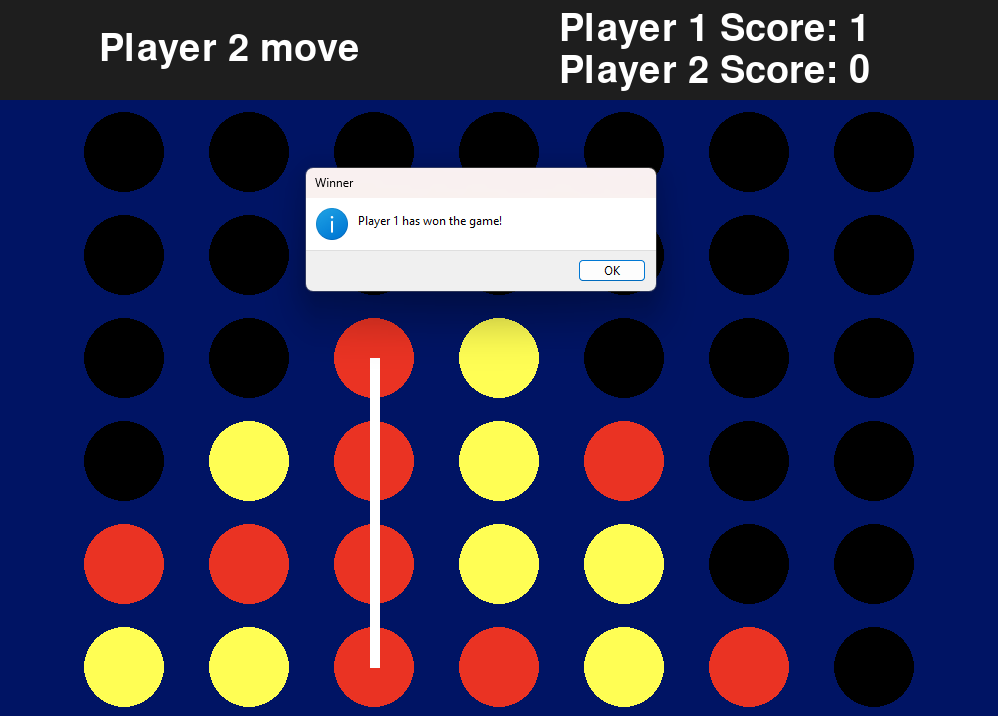

# Connect Four

A two-player Connect Four game built in Python with Pygame. Take turns dropping red and yellow discs into a 7x6 grid and be the first to line up four in a row, either horizontally, vertically or diagonally.



## Features

- Local two-player game on one computer, played with the mouse
- 7x6 board with discs that only land on a valid spot (the bottom row or on top of another disc)
- Turn indicator showing whose move it is
- Win detection in all four directions: horizontal, vertical and both diagonals
- A line is drawn through the winning four discs
- Score tracking across rounds
- Tie detection when the board is full
- Pop-up message at the end of each round, then the board resets automatically

## Tech Stack

- **Python 3.12+** (the code uses nested quotes inside f-strings, which need 3.12 or newer)
- **pygame-ce** for the window, drawing, input and message boxes
- **NumPy** for the board and slot positions

> **Note:** the game uses `pygame.display.message_box`, which only exists in **pygame-ce** (2.4.0 and newer), not in the original `pygame` package. If you have both installed, uninstall `pygame` first so the two don't conflict.

## Getting Started

### 1. Clone the repository

```bash
git clone https://github.com/jaydenbau-cmd/Connect4-Game.git
cd ConnectFour
```

### 2. Create a virtual environment (recommended)

```bash
python -m venv venv
```

Activate it:

```bash
# Windows
venv\Scripts\activate

# macOS / Linux
source venv/bin/activate
```

### 3. Install the dependencies

```bash
pip install pygame-ce numpy
```

### 4. Run the game

```bash
python main.py
```

## How to Play

1. Player 1 (red) goes first, then the players alternate.
2. Click the **lowest empty slot** in the column where you want to drop your disc.
3. Get four of your discs in a row to win the round.
4. The score is updated, the board resets, and you can play again right away.
5. Close the window to quit.

## How It Works

- **Board:** a 6x7 NumPy array where `0` is empty, `1` is Player 1 and `2` is Player 2.
- **Slot positions:** the centre of every slot is calculated once at startup from the window size and stored in a second array, so drawing and click detection use the same coordinates.
- **Move validation (`check_move`):** a click counts if it lands within 40 pixels of an empty slot that is either on the bottom row or has a disc directly below it. This is what makes discs "fall" to the correct spot.
- **Win check (`get_winner`):** after every move, the game counts matching discs in both directions along each of four axes starting from the disc that was just placed. Four or more in a row is a win, and the start and end slots are returned so the winning line can be drawn.
- **Tie check (`is_board_full`):** if no empty slots remain, the round ends in a tie.

## Project Structure

```
ConnectFour/
├── main.py            # Game loop, drawing and game logic
├── requirements.txt   # Dependencies
└── README.md
```

`requirements.txt`:

```
pygame-ce
numpy
```

## Roadmap

Planned upgrades:

- [ ] Fully functional AI opponent (single-player mode)
  - [ ] Minimax with alpha-beta pruning as a baseline opponent
  - [ ] Reinforcement learning agent trained through self-play
  - [ ] Selectable difficulty levels
- [ ] Separate the game logic from the drawing code so the AI can reuse it
- [ ] Start menu to choose between two players and playing against the AI
- [ ] Hover preview of where the disc will land
- [ ] Unit tests for the win and move checks

## Author

**Jayden Baumann**
